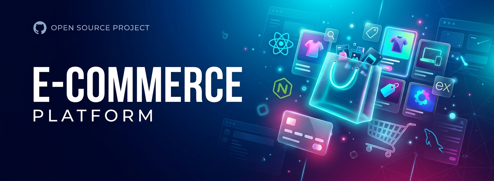

# 🛒 Full-Stack E-commerce Platform

<p align="center">
  
</p>

<p align="center">
  
  
  
  
  
  
  
</p>

> 🇫🇷 **Plateforme e-commerce complète** avec catalogue produits, panier, paiement, espace utilisateur et back-office administrateur.
> 🇬🇧 **Comprehensive e-commerce platform** with product catalog, cart, checkout, user space and admin back-office.

---

## 📋 Table of Contents

- [Demo](#-demo)
- [Architecture](#-architecture)
- [Features](#-features)
- [Tech Stack](#-tech-stack)
- [Project Structure](#-project-structure)
- [Quick Start](#-quick-start)
- [Environment Variables](#-environment-variables)
- [API Endpoints](#-api-endpoints)
- [Database Schema](#-database-schema)
- [Roadmap](#-roadmap)
- [Author](#-author)
- [License](#-license)

---

## 🎬 Demo

| Home Page | Product Detail | Checkout |
|-----------|----------------|----------|
| _Screenshot_ | _Screenshot_ | _Screenshot_ |

> 🚧 Live demo coming soon — clone the repo to run locally.

---

## 🏛️ Architecture

```
┌──────────────┐   HTTPS / REST   ┌──────────────┐   SQL    ┌──────────────┐
│   React SPA  │  ───────────────►│  Express API │ ────────►│    MySQL     │
│   (Vite)     │  ◄───────────────│  (Node.js)   │ ◄────────│              │
└──────────────┘     JSON / JWT   └──────────────┘          └──────────────┘
       │                                  │
       │                                  ├─► JWT Auth Middleware
       └─► Axios + Context API            ├─► Stripe Payment (planned)
                                          └─► Bcrypt Password Hashing
```

---

## ✨ Features

### 🛍️ Customer Side
- 🔍 Product catalog with **search**, **filtering** & **pagination**
- 🛒 Persistent shopping **cart** (localStorage + backend sync)
- 💳 Secure **checkout flow**
- 👤 User account: profile, addresses, **order history**
- ⭐ Product reviews & ratings
- 📱 Fully **responsive** mobile-first design

### 🛠️ Admin Back-Office
- 📦 Products CRUD (create, update, soft-delete, image upload)
- 📊 Orders management (status workflow: pending → shipped → delivered)
- 👥 Users management & role assignment
- 📈 Sales dashboard with KPIs

### 🔐 Security
- JWT-based authentication with refresh tokens
- Password hashing via **bcrypt**
- Role-Based Access Control (`customer` / `admin`)
- CORS, Helmet, rate-limiting middleware
- SQL-injection prevention via parameterized queries

---

## 🚀 Tech Stack

| Layer       | Technology                               |
|-------------|------------------------------------------|
| Frontend    | React.js 18, React Router, Axios, Context API |
| Styling     | Tailwind CSS / Bootstrap                 |
| Backend     | Node.js 18, Express.js 4                 |
| Database    | MySQL 8.0                                |
| Auth        | JSON Web Tokens (JWT) + bcrypt           |
| Validation  | express-validator                        |
| Dev Tools   | Nodemon, ESLint, Prettier                |

---

## 📁 Project Structure

```
ecommerce-fullstack/
├── backend/
│   ├── config/          # DB connection, env loader
│   ├── controllers/     # Business logic
│   ├── middleware/      # Auth, error handler, validators
│   ├── models/          # Database queries
│   ├── routes/          # Express routers
│   ├── server.js        # App entry point
│   ├── package.json
│   └── .env.example
└── frontend/
    ├── public/
    ├── src/
    │   ├── components/  # Reusable UI (Navbar, ProductCard...)
    │   ├── pages/       # Home, Cart, Checkout, Admin...
    │   ├── services/    # API client (axios)
    │   ├── context/     # Auth & Cart context
    │   └── App.js
    └── package.json
```

---

## ⚡ Quick Start

### Prerequisites
- Node.js ≥ 18
- MySQL ≥ 8
- npm or yarn

### 1️⃣ Clone the repository
```bash
git clone https://github.com/boss-last/ecommerce-fullstack.git
cd ecommerce-fullstack
```

### 2️⃣ Backend setup
```bash
cd backend
cp .env.example .env       # Then edit your DB credentials
npm install
npm run dev                # Server: http://localhost:5000
```

### 3️⃣ Frontend setup (new terminal)
```bash
cd frontend
npm install
npm start                  # App: http://localhost:3000
```

---

## 🔧 Environment Variables

Create `backend/.env` from `.env.example`:

```env
PORT=5000
DB_HOST=localhost
DB_PORT=3306
DB_USER=root
DB_PASSWORD=your_password
DB_NAME=ecommerce_db
JWT_SECRET=change_me_to_a_long_random_string
JWT_EXPIRES_IN=7d
NODE_ENV=development
```

---

## 📡 API Endpoints

| Method | Endpoint                  | Description             | Auth   |
|--------|---------------------------|-------------------------|--------|
| POST   | `/api/auth/register`      | Create new user         | Public |
| POST   | `/api/auth/login`         | Authenticate user       | Public |
| GET    | `/api/products`           | List products (paginated)| Public |
| GET    | `/api/products/:id`       | Product detail          | Public |
| POST   | `/api/products`           | Create product          | Admin  |
| PUT    | `/api/products/:id`       | Update product          | Admin  |
| DELETE | `/api/products/:id`       | Delete product          | Admin  |
| GET    | `/api/orders`             | User's orders           | User   |
| POST   | `/api/orders`             | Create order            | User   |
| PATCH  | `/api/orders/:id/status`  | Update order status     | Admin  |

---

## 🗄️ Database Schema

```sql
users (id, email, password_hash, name, role, created_at)
products (id, name, description, price, stock, image_url, category_id)
categories (id, name, slug)
orders (id, user_id, total, status, shipping_address, created_at)
order_items (id, order_id, product_id, quantity, unit_price)
reviews (id, user_id, product_id, rating, comment, created_at)
```

---

## 🗺️ Roadmap

- [x] Project skeleton & auth
- [x] Product catalog
- [ ] Stripe payment integration
- [ ] Email notifications (SendGrid)
- [ ] Wishlist feature
- [ ] Multi-vendor support
- [ ] Mobile app (React Native)

---

## 👨‍💻 Author

**Bamba Amara Christian** — Full-Stack Developer
- 🌐 Portfolio: [boss-last on GitHub](https://github.com/boss-last)
- 💼 Open to opportunities

---

## 📄 License

Released under the [MIT License](LICENSE).
