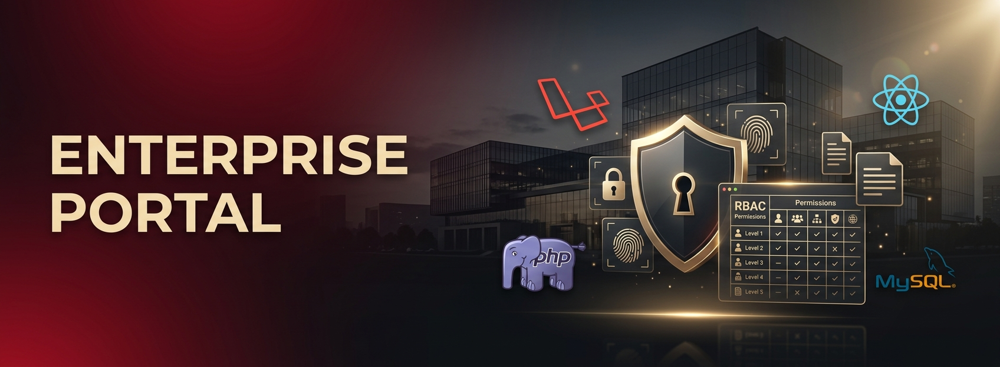

# 🏢 Laravel Enterprise Portal

<p align="center">
  
</p>

<p align="center">
  
  
  
  
  
  
</p>

> 🇫🇷 **Portail d'entreprise sur mesure** avec authentification SSO, gestion documentaire, RBAC fin et API RESTful pour les intégrations ERP/CRM.
> 🇬🇧 **Custom enterprise portal** with SSO authentication, document management, fine-grained RBAC and a RESTful API for ERP/CRM integrations.

---

## 📋 Table of Contents
- [Demo](#-demo)
- [Architecture](#-architecture)
- [Features](#-features)
- [Tech Stack](#-tech-stack)
- [Project Structure](#-project-structure)
- [Quick Start](#-quick-start)
- [Environment Variables](#-environment-variables)
- [Permissions Matrix](#-permissions-matrix)
- [API Endpoints](#-api-endpoints)
- [Roadmap](#-roadmap)
- [Author](#-author)

---

## 🎬 Demo

| Dashboard | Document Vault | Admin RBAC |
|-----------|----------------|------------|
| _Screenshot_ | _Screenshot_ | _Screenshot_ |

---

## 🏛️ Architecture

```
┌──────────────────┐                 ┌────────────────────┐               ┌────────────┐
│  React (Inertia) │ ── HTTP/JSON ──►│  Laravel 10 (PHP)  │ ── Eloquent ──►   MySQL     │
│   + Tailwind     │ ◄── views ──────│  Sanctum / Policies│ ◄── Cache ────  Redis(opt) │
└──────────────────┘                 └────────────────────┘               └────────────┘
                                              │
                                              ├─► SSO (SAML / OAuth2)
                                              ├─► Queue worker (Horizon)
                                              └─► REST API (`/api/v1`)
```

---

## ✨ Features

### 🔐 Authentication & Access
- **SSO** support (SAML 2.0, OAuth2, Azure AD)
- 2-Factor Authentication (TOTP)
- **RBAC** with Spatie Permissions (roles + granular permissions)
- Session timeout & device management

### 📄 Document Management
- Upload / preview / download
- Versioning with audit trail
- Tagging, full-text search (Scout + Meilisearch)
- Granular access per folder / document

### 🧩 Modules
- Employee directory & org-chart
- Internal news feed & announcements
- Time-off requests workflow
- Expense reports
- ERP/CRM webhook integrations

### 🛠️ Admin
- User & role management UI
- Activity log (Spatie Activitylog)
- System health monitor

---

## 🚀 Tech Stack

| Layer       | Technology                                |
|-------------|-------------------------------------------|
| Backend     | Laravel 10, PHP 8.2                       |
| Frontend    | React 18 + Inertia.js + Tailwind CSS      |
| Database    | MySQL 8.0                                 |
| Cache/Queue | Redis 7 + Laravel Horizon                 |
| Auth        | Laravel Sanctum + Spatie Permission       |
| Search      | Meilisearch (Laravel Scout)               |
| Deployment  | Docker, GitHub Actions CI/CD              |

---

## 📁 Project Structure

```
laravel-enterprise-portal/
├── app/
│   ├── Http/
│   │   ├── Controllers/    # Web + API controllers
│   │   └── Middleware/
│   └── Models/             # Eloquent models
├── database/
│   └── migrations/
├── routes/
│   ├── web.php             # Inertia routes
│   └── api.php             # JSON API routes
└── resources/
    ├── js/components/      # React components
    └── views/              # Blade templates
```

---

## ⚡ Quick Start

### Prerequisites
- PHP ≥ 8.2, Composer ≥ 2.6
- Node.js ≥ 18, MySQL ≥ 8

### Installation
```bash
git clone https://github.com/boss-last/laravel-enterprise-portal.git
cd laravel-enterprise-portal

# Backend
composer install
cp .env.example .env
php artisan key:generate
php artisan migrate --seed

# Frontend
npm install
npm run dev

# Serve
php artisan serve            # http://localhost:8000
```

---

## 🔧 Environment Variables

```env
APP_NAME="Enterprise Portal"
APP_ENV=local
APP_KEY=
APP_DEBUG=true
APP_URL=http://localhost:8000

DB_CONNECTION=mysql
DB_HOST=127.0.0.1
DB_PORT=3306
DB_DATABASE=enterprise_portal
DB_USERNAME=root
DB_PASSWORD=

REDIS_HOST=127.0.0.1
QUEUE_CONNECTION=redis
SCOUT_DRIVER=meilisearch
MEILISEARCH_HOST=http://localhost:7700
```

---

## 🔑 Permissions Matrix

| Permission            | Admin | Manager | Employee | Guest |
|-----------------------|:-----:|:-------:|:--------:|:-----:|
| Manage users          | ✅    | ❌      | ❌       | ❌    |
| Manage documents      | ✅    | ✅      | ❌       | ❌    |
| Upload documents      | ✅    | ✅      | ✅       | ❌    |
| View public docs      | ✅    | ✅      | ✅       | ✅    |
| Approve time-off      | ✅    | ✅      | ❌       | ❌    |

---

## 📡 API Endpoints (sample)

| Method | Endpoint                  | Description           |
|--------|---------------------------|-----------------------|
| POST   | `/api/v1/auth/login`      | Authenticate          |
| GET    | `/api/v1/users`           | List users (paginated)|
| GET    | `/api/v1/documents`       | List documents        |
| POST   | `/api/v1/documents`       | Upload document       |
| POST   | `/api/v1/timeoff`         | Submit time-off       |

---

## 🗺️ Roadmap

- [x] Auth + RBAC
- [x] Document vault
- [ ] Mobile app (Flutter)
- [ ] AI document summarization
- [ ] Slack & Teams notifications

---

## 👨‍💻 Author

**Bamba Amara Christian** — Full-Stack Developer · [GitHub](https://github.com/boss-last)

## 📄 License

Proprietary — All rights reserved.
