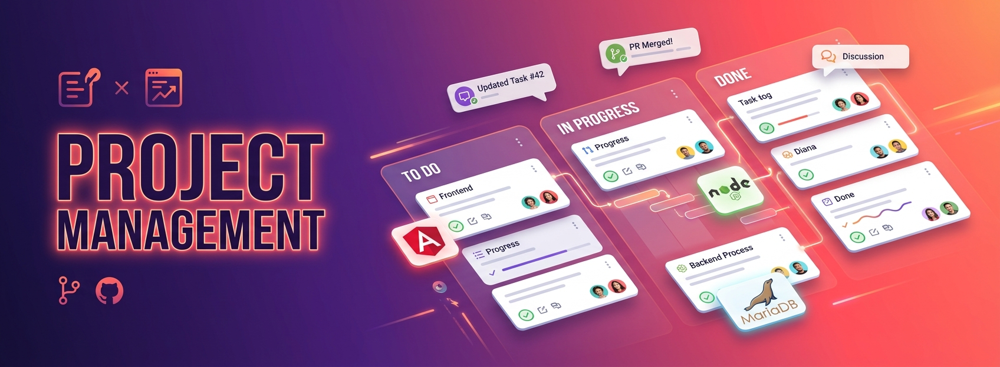

# 📋 Project Management Application

<p align="center">
  
</p>

<p align="center">
  
  
  
  
  
  
</p>

> 🇫🇷 **Application collaborative de gestion de projet** : tableaux Kanban, suivi des tâches, équipes, chat temps réel et reporting de productivité.
> 🇬🇧 **Collaborative project management tool**: Kanban boards, task tracking, team management, real-time chat and productivity reporting.

---

## 📋 Table of Contents
- [Demo](#-demo)
- [Architecture](#-architecture)
- [Features](#-features)
- [Tech Stack](#-tech-stack)
- [Project Structure](#-project-structure)
- [Quick Start](#-quick-start)
- [Environment Variables](#-environment-variables)
- [API Endpoints](#-api-endpoints)
- [Real-time Events](#-real-time-events)
- [Roadmap](#-roadmap)
- [Author](#-author)

---

## 🎬 Demo

| Kanban Board | Task Detail | Team Chat |
|--------------|-------------|-----------|
| _Screenshot_ | _Screenshot_ | _Screenshot_ |

---

## 🏛️ Architecture

```
┌─────────────────┐                  ┌──────────────────┐               ┌─────────────┐
│   Angular SPA   │  ── REST API ──► │  Express + WS    │ ── SQL ─────► │   MariaDB   │
│  (Standalone)   │  ◄── JSON ────── │  (Node.js 18)    │ ◄── Pool ──── │             │
└─────────────────┘                  └──────────────────┘               └─────────────┘
        │                                     │
        └─── WebSocket (Socket.io) ───────────┘   ⇒ Live notifications, chat, board sync
```

---

## ✨ Features

### 📊 Project Management
- 🗂️ Multiple **projects** & workspaces
- 🪪 **Kanban** boards with drag-and-drop columns (To-do, Doing, Review, Done)
- ✅ Tasks with **assignees**, **labels**, **due dates**, **checklists** & file attachments
- 🔍 Powerful filters (assignee, label, status, due date)
- 📈 **Burn-down** & velocity charts

### 👥 Team Collaboration
- 💬 Real-time **chat** per project channel (Socket.io)
- 🔔 Live **notifications** (assignment, mention, comment)
- 🧑‍🤝‍🧑 Roles: **Admin** / **Manager** / **Developer** / **Viewer**
- 📨 Email invitations to join a project

### 🔐 Security & Auth
- JWT authentication with refresh tokens
- Role-Based Access Control (RBAC)
- Audit log of critical actions

### 📑 Reporting
- Productivity report per user / per sprint
- Export to PDF / CSV

---

## 🚀 Tech Stack

| Layer       | Technology                                   |
|-------------|----------------------------------------------|
| Frontend    | Angular 17 (standalone components, signals)  |
| UI          | Angular Material + SCSS                      |
| State       | RxJS + NgRx (optional)                       |
| Backend     | Node.js 18, Express 4                        |
| Real-time   | Socket.io 4                                  |
| Database    | MariaDB 10.11                                |
| ORM         | Sequelize / Knex                             |
| Auth        | JWT + bcrypt                                 |

---

## 📁 Project Structure

```
project-management-app/
├── api/                       # Express backend
│   ├── routes/
│   ├── controllers/
│   ├── models/
│   ├── middleware/
│   ├── sockets/               # Socket.io handlers
│   ├── server.js
│   └── package.json
└── client/                    # Angular frontend
    └── src/
        └── app/
            ├── components/
            ├── services/
            ├── models/
            └── guards/
```

---

## ⚡ Quick Start

### Prerequisites
- Node.js ≥ 18, Angular CLI ≥ 17, MariaDB ≥ 10.11

### Backend
```bash
cd api
cp .env.example .env
npm install
npm run dev          # http://localhost:4000
```

### Frontend
```bash
cd client
npm install
ng serve             # http://localhost:4200
```

---

## 🔧 Environment Variables

`api/.env`
```env
PORT=4000
DB_HOST=localhost
DB_PORT=3306
DB_USER=root
DB_PASSWORD=secret
DB_NAME=pm_app
JWT_SECRET=replace_me
CLIENT_ORIGIN=http://localhost:4200
```

---

## 📡 API Endpoints

| Method | Endpoint                       | Description           |
|--------|--------------------------------|-----------------------|
| POST   | `/api/auth/login`              | User login            |
| GET    | `/api/projects`                | List user's projects  |
| POST   | `/api/projects`                | Create new project    |
| GET    | `/api/projects/:id/tasks`      | List project tasks    |
| POST   | `/api/projects/:id/tasks`      | Create task           |
| PATCH  | `/api/tasks/:id`               | Update task / move    |
| POST   | `/api/projects/:id/members`    | Invite member         |

---

## 🔌 Real-time Events (Socket.io)

| Event                | Direction | Payload                          |
|----------------------|-----------|----------------------------------|
| `task:created`       | S → C     | `{ task, projectId }`            |
| `task:updated`       | S → C     | `{ task, projectId }`            |
| `task:moved`         | S → C     | `{ taskId, fromCol, toCol }`     |
| `chat:message`       | C ↔ S     | `{ projectId, text, userId }`    |
| `notification`       | S → C     | `{ type, message, link }`        |

---

## 🗺️ Roadmap

- [x] Auth + project CRUD
- [x] Kanban + drag & drop
- [ ] Gantt chart view
- [ ] GitHub & Slack integrations
- [ ] Mobile companion app
- [ ] AI-powered task suggestions

---

## 👨‍💻 Author

**Bamba Amara Christian** — Full-Stack Developer · [GitHub](https://github.com/boss-last)

## 📄 License

MIT — see [LICENSE](LICENSE)
